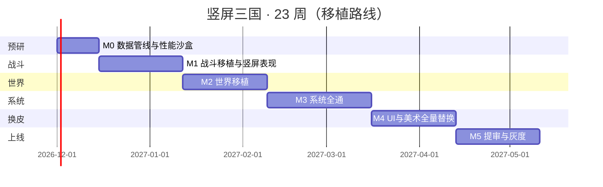

# 05 · 里程碑与任务拆解

> **v1 = 移植，不是重做**（`PROJECT_BRIEF §2`：系统零改动）。所以这份 WBS 的重心是：
> **① 把原作逻辑 1:1 搬过来；② 把画面/版式换成竖屏；③ 把 11,000 张美术换成新的。**
> 23 周 / **8 人**（美术 4.5）/ 6 个质量门。

---

## 0. 实际进度快照（2026-11-24，与下面 23 周计划的对照）

> 这一节是「现实 vs 计划」，计划本身不改。判据一律是"能跑/有截图/有测试"，不看文档写了多少。

| 里程碑 | 计划内容 | 现实状态 | 证据 |
|---|---|---|---|
| M0 预研 | 引擎跑通 / 性能沙盒 / 数据管线 / 金标准 3 张 | ✅ **超预期完成** | 数据管线 13 JSON + 40 项校验；Qwen/Wan 全链路跑通；云批 400 将 |
| M1 战斗 | BattleWorld / 14×60 坐标 / 9 阵形 / 命中伤害 / 相克 / 小队 AI / HUD / 结算 | ✅ **完成（web）** | 27 条测试；100v100 实跑；相克/阵形/士气/双资源技能全接 |
| M2 世界 | 大地图 / 20 城 / 寻路 / 月循环 / 编成 / 攻城 / AI / 存档 | ✅ **完成（web，60 城全量）** | 原作底图零错位；AI 出兵 + 守城战；10 槽存档 + 5 剧本 |
| M3 闭环 | 招降斩首 / 战利品 / 养成 / 40 技 / 20 军师技 / 通关 / 引导 | 🟡 **大半**：招降/斩首/掉落/77 件装备/升级已通；**通关与引导未做**；110 技只接了 4 个 | `19`/`14` 文档 + 结算面板截图 |
| M4 换皮 | 全量美术替换 + 竖屏 UI | 🟡 **样板齐全**：400 将立绘、26 兵种、4 套动作、818 帧特效、九屏 UI、6 张 AI 底图 | `art_ref` / `proto/ui` / `game/web` |
| M5 提审 | 微信包 + 真机 + 版号 | 🟡 **构建通、包体超标**：wechatgame exit 0，首包 31.72 MB（上限 7.93×） | `23` 文档；瘦身进行中 |

**结论**：能跑的东西比计划多（web 全链路可玩），但"能上线"的两道硬门槛没变——**包体**和**真机**。

## 0. 总览

| 里程碑 | 主题 | 周期 | 一句话验收 |
|---|---|---|---|
| **M0** | 预研与数据管线 | W1–W2 | 10 个 INI 全量转 JSON 且逐字段对拍通过；100 假人真机 30 fps |
| **M1** | 战斗移植 | W3–W6 | 同一场战斗，原作与新端结果一致（同 seed 对拍） |
| **M2** | 世界移植 | W7–W10 | 5 剧本能载入，60 城能走，月循环能过 |
| **M3** | 系统全通 | W11–W15 | 从开局到通关全流程无阻断，功能覆盖矩阵 100% |
| **M4** | UI 与美术全量替换 | W16–W19 | 没有一张原作素材，没有一处版式错位 |
| **M5** | 提审上线 | W20–W23 | 过审、灰度、崩溃率 < 0.3% |



---

## 1. M0 · 预研与数据管线（2 周）— 决定后面所有产能

> **快速验证通道（云已开）**：用户要求「能用云加速就加速」，因此 M0 的第 0 周改为**与云并行**——
> D1 开云跑 `cloud/jobs_v0.csv`（27 条，6–8 min），D2 出金标准 3 张，同时本地跑 M0-1/M0-2。
> 10 天冲刺的逐日排期见 `07_云GPU提速与快速验证方案.md` §11。

| # | 任务 | 人日 | 角色 | 交付 | 验收 |
|---|---|---|---|---|---|
| M0-1 | Cocos 3.8 工程初始化 + 微信小游戏真机跑通 | 2 | 前端 | 空场景 | 首包 ≤ 4 MB，真机可开 |
| M0-2 | **性能沙盒**：100 个动画单位 + 最重特效 + 1/30 固定步长 | 4 | 前端 | `perf_sandbox` | 骁龙 660 / iPhone 8 **≥30 fps 稳定 3 分钟**，内存 ≤ 200 MB |
| M0-3 | 渲染选型验证：序列帧合批 vs Spine vs 骨骼 | 2 | 前端 | 对比数据 | 写入 `04 §4.3`（`03 §3` 建议"士兵序列帧 + 主将 Spine"） |
| M0-4 | **数据管线**：`import_legacy.py` 把 10 个 INI 1:1 转 JSON | 5 | 前端+策划 | `data/*.json` ✅ **已完成** | **14 项对拍全过**（10 条数 + 2 字段 + 2 矩阵反对称），详见 `08_数据迁移与对拍.md` |
| M0-5 | 原始素材解码复用：`export/png` 的 10,969 张作**占位图**接进工程 | 2 | 前端 | 占位资源包 | 能用原作图跑通全流程（仅内部开发，**不发布**） |
| M0-6 | 美术金标准 3 张 + 批 1 首批（40 头像 + 双视角兵种底稿） | 2 | 美术 | `art_ref/gold_*` | **云上跑**（`07` §4–§5）：`cloud/jobs_v0.csv` 27 条 6–8 min；`06 §8` 八道闸门全过 |
| M0-7 | Wan 视频转帧链路端到端跑通（一条兵种 walk → 序列帧进游戏） | 2 | 美术+前端 | `tools/anim_pipeline` | 12 帧序列帧在真机播放不抖；**注意 Wan 5B 动作幅度偏小**（`07` §10.1） |

**Gate**：M0-2 不达标 → 立刻换渲染方案；M0-4 对拍不过 → 不许进 M1（数据错了后面全错）。

---

## 2. M1 · 战斗移植（4 周）— 逻辑照抄，画面重排

| # | 任务 | 人日 | 角色 | 交付 | 验收 |
|---|---|---|---|---|---|
| M1-1 | 战斗核心：单位数组、固定 30 Hz、空间哈希、消息分发 | 5 | 前端 | `core/battle` | 200 单位 update ≤ 3 ms |
| M1-2 | **照抄**原作的战斗数值：五段加算、`rand()%300<战力`、打武将 `150±武力差/2`、士兵即死 | 3 | 前端 | `combat.ts` | 与 `docs/04b` `04b4` 逐行对拍 |
| M1-3 | 13 兵种相克（13×13 @`0x48CD88`）+ 阵形（9×9）+ 地形修正（12×13） | 3 | 前端 | `counter.json` | 三张表与 `docs/03b` 数值完全一致 |
| M1-4 | 100 兵 = 10 小队 ×10 人，33 组布阵数组原样搬 + 单兵寻路 | 6 | 前端 | `core/battle/formation` | 9 阵形落位与原作截图一致 |
| M1-5 | **竖屏表现层**：逻辑坐标(71 列 ×14 行) → 竖屏投影（转 90°、我方在下、敌方在上） | 5 | 前端 | `BattleView` | 一屏 14 车道 × 12.6 行；纵向镜头不抖；HUD 不挡主将 |
| M1-6 | 武将技释放（110 技的**框架**，先接 20 个真特效） | 4 | 前端+美术 | `skills/` | 气力=power×1200、MP 扣减与原作一致 |
| M1-7 | 军师技（67 个的框架，先接 10 个） | 2 | 前端 | `wise/` | 生效时机（战前）与原作一致 |
| M1-8 | 战斗 HUD（竖屏）：兵力/士气/技力/撤退/加速/技能格 | 3 | 前端+UI | `BattleHUD` | 单手可完成一局 |
| M1-9 | 结算：经验 `f(n)=((n−1)×137−34)×n/2+17`、战功、士气惩罚 | 2 | 前端 | `aftermath.ts` | 数值与原作 `docs/04b` 一致 |
| M1-10 | **对拍工具**：同 seed 跑原作与新端，比对逐帧结果 | 3 | 前端 | `tools/parity` | 10 场战斗结果差异 = 0 |

**Gate**：**同 seed 同阵容，两端战斗结果一致**（这是"零改动"最硬的证明）。

---

## 3. M2 · 世界移植（4 周）

| # | 任务 | 人日 | 角色 | 交付 | 验收 |
|---|---|---|---|---|---|
| M2-1 | 大地图渲染：1280×960 重构图/分片、城池点、路径、缩放拖拽 | 5 | 前端 | `LobbyScene` | 60 城 116 路流畅；竖屏可看清 |
| M2-2 | 寻路：原作路径表（116 条，39 条 `Length=30000` 哨兵不可走） | 2 | 前端 | `pathfind.ts` | 与 `docs/08 §3.4` 的可通行图一致（77 条） |
| M2-3 | 月循环：时间推进、收入、征兵/训练/搜索/开发（公式照抄 `docs/04c`） | 5 | 前端 | `core/turn` | 12 个月数值与原作一致 |
| M2-4 | 5 剧本载入（`TIMES1-5.INI`，15 君主 / 60 城 / 116 路径 / 401 将） | 3 | 前端 | `scenario/` | 5 个剧本开局状态与原作一致 |
| M2-5 | 出征编成：选将（≤5 人）/配兵/阵形/军师技 | 4 | 前端+UI | `MarchSetup` | 竖屏两屏内完成 |
| M2-6 | 攻城/守城/遭遇：进入战斗（带地形与攻城修正） | 3 | 前端 | `campaign/` | 三种战斗类型都能进 |
| M2-7 | AI：每月 1 动作、权重 200/100/50、出兵数公式（照抄 `docs/04c`） | 4 | 前端 | `core/ai` | 5 剧本 AI 都能推进世界 |
| M2-8 | 存档：`SSAV` 七段结构 1:1（`docs/07`），10 槽 + 版本迁移 | 4 | 前端 | `SaveSystem` | 原存档字段能读写（结构一致） |

**Gate**：能载入任一剧本、走完 12 个月、AI 会主动来打、存档不坏。

---

## 4. M3 · 系统全通（5 周）

| # | 任务 | 人日 | 角色 | 交付 | 验收 |
|---|---|---|---|---|---|
| M3-1 | 招降/斩首/释放（条件与公式照抄 `docs/04b2`） | 4 | 前端 | `aftermath` | 三种结果概率与原作一致 |
| M3-2 | 战后补兵（吃城池预备兵：`min(人口/2500+110,600)`） | 2 | 前端 | `replenish` | 数值一致 |
| M3-3 | 77 件物品：掉落、装备、唯一性 `ONLYONE`、兵符换兵种 | 4 | 前端 | `item/` | 全 77 件可用 |
| M3-4 | 武将养成：升级（`+0x2E` 无封顶）、带兵数 `min(等级×5,100)`、骑兵 `clamp((等级−20)×5,0,100)` | 3 | 前端 | `progress.ts` | 与原作字段一致 |
| M3-5 | 110 武将技全接（特效来自 `06` 批 3） | 6 | 前端+美术 | `skills/` | 全部可释放不崩 |
| M3-6 | 67 军师技全接 | 4 | 前端 | `wise/` | 全部生效 |
| M3-7 | 通关判定与结局（消灭所有敌对势力） | 2 | 策划 | `victory` | 5 剧本都能通关 |
| M3-8 | 功能覆盖矩阵验收（`01 §5.5`）：逐项走查 | 3 | 策划 | 走查报告 | **100% 可到达** |

**Gate**：**功能覆盖矩阵 100%**——原作每个可操作项，v1 都能走到。

---

## 5. M4 · UI 与美术全量替换（4 周）

| # | 任务 | 人日 | 角色 | 交付 | 验收 |
|---|---|---|---|---|---|
| M4-1 | 7 主界面 + 全部 L2/L3 换新皮（`01`） | 8 | 前端+UI | 全界面 | 无占位图、无错位 |
| M4-2 | 400 头像入包 + 分级加载（CDN 分包） | 4 | 美术+前端 | `hero_atlas` | 400 张全部可显示 |
| M4-3 | 战场单位全量替换：**13 兵种 × 双视角 = 26 组（620 帧）** + 主将 8 套 skin（104 部件）+ 马 16 组 | 12 | 美术 | 序列帧 | 100 单位同屏帧率达标；背/正朝向一眼可辨 |
| M4-4 | 12 地形 × 竖屏分层 + 大地图重制 | 5 | 美术 | 场景资源 | 12 种地形都能进 |
| M4-5 | 技能特效 110 个 | 6 | 美术 | `fx/` | 每个技能都有专属特效 |
| M4-6 | 适配：19.5:9 / 4:3 / 安全区 | 3 | 前端 | 适配层 | 3 种机型无遮挡 |
| M4-7 | 性能调优到指标（`04 §8`） | 4 | 前端 | 性能报告 | 全部指标达标 |

---

## 6. M5 · 提审上线（4 周）

| # | 任务 | 人日 | 角色 | 验收 |
|---|---|---|---|---|
| M5-1 | 微信能力接入（登录/激励视频/分享/上报） | 3 | 前端 | 真机可看广告拿奖励 |
| M5-2 | 埋点与看板 | 2 | 前端+后端 | 关键漏斗可见 |
| M5-3 | 灰度 10%→50%→100% | 5 | 全员 | 崩溃率 < 0.3% |
| M5-4 | 版号/合规材料 | — | 制作人 | 过审 |
| M5-5 | 运营准备（公告/客服/回滚预案） | 3 | 制作人 | 有回滚预案 |

---

## 7. 关键路径与依赖

```
M0-4 数据管线 ──▶ M1-2/1-3 数值照抄 ──▶ M1-10 对拍 ──▶ M2 世界 ──▶ M3 系统全通 ──▶ M4 换皮
M0-2 性能沙盒 ──▶ M0-3 渲染选型 ──▶ M1-1/1-5 战斗与竖屏表现 ──┘
M0-6 美术金标准 ──▶ M0-7 视频转帧链路 ──▶ M4-3/4-5 全量美术
```

**三条不能拖的**：数据管线（错一个字段后面全错）、性能沙盒（决定渲染方案）、视频转帧链路（决定动作美术产能）。

---

## 8. 人力与成本

| 角色 | 人 | 人日 | 主要投入 |
|---|---|---|---|
| 制作人/主策 | 1 | 115 | 数值对拍、覆盖矩阵、验收、对外 |
| 客户端 | 2 | 230 | 战斗/世界/系统移植、UI、平台 |
| 美术（原画+UI） | 3 | 345 | 头像、UI、主将部件、精修 |
| **动画/特效** | **1.5** | **172** | **双视角序列帧、技能特效（Wan 视频转帧）** |
| 后端/运维 | 0.5 | 57 | 登录、云存档、CDN、看板 |
| **合计** | **8** | **919 人日** | 23 周（约 5.3 月 × 22 天） |

> **算法**：美术 600 人日（`03 §3.13.6`）÷ 23 周（115 个工作日）= **5.2 美术人力**，故配 3 原画 + 1.5 动画 = 4.5，剩下 0.7 靠"分级交付"（400 头像分 40 精修 / 160 中档 / 200 换色）吸收。
> **如果只能给 3 个美术**（总 6 人）：周期按 600/3/22 ≈ 30 周排，M4 从 4 周拉到 11 周；**不要靠加班补**，精修是质量活。
> **云 GPU**：批 2/批 3 约 ¥200~800（`06 §5`），可忽略。

---

## 9. 范围裁剪预案（只砍美术，不砍功能）

| 顺序 | 砍什么 | 影响 |
|---|---|---|
| 1 | 头像从"精修"降级为"AI 直出 + 轻修" | 质感下降，功能不变 |
| 2 | 技能特效先做 40 个，其余复用同类 | 表现下降，功能不变 |
| 3 | 12 地形减到 6 种（其余复用最近地形） | 场景重复，功能不变 |
| 4 | 立绘从"3/4 身"降为"胸像" | 表现下降 |
| 5 | 过场/CG 全部走 CDN 延后 | 首包变小 |

**永远不砍**：**功能覆盖矩阵 100%**、100 人兵战、13 兵种、9 阵形、5 剧本、400 将——这些是"零改动"的底线。

---

## 10. 第一周就能开工的 8 件事

1. 装 Cocos Creator 3.8.x，构建微信小游戏，真机打开（M0-1）
2. 100 个方块 + 固定步长循环，测帧率（M0-2）
3. `import_legacy.py` 把 `TIMES1.INI` 60 城转 JSON，人工抽 5 城核对（M0-4）
4. 用 Qwen 出 3 张金标准 + 40 头像首批（M0-6）
5. 跑通一条 Wan 动作片 → 12 帧序列帧进 Cocos（M0-7）
6. 把 `docs/03b` 的 13×13 相克矩阵导成 `counter.json`（M1-3）
7. 把 `docs/04b` 的战斗公式写成纯 TS 函数 + 单测（M1-2）
8. 出一版"竖屏战斗构图"静态 mock（M1-5 的前置）
