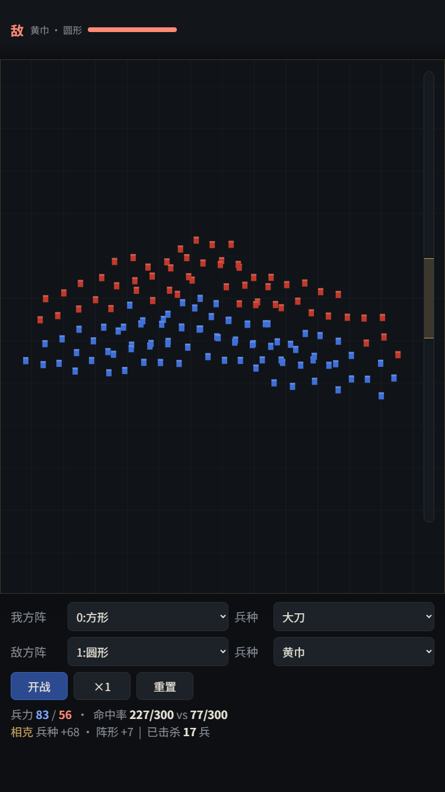
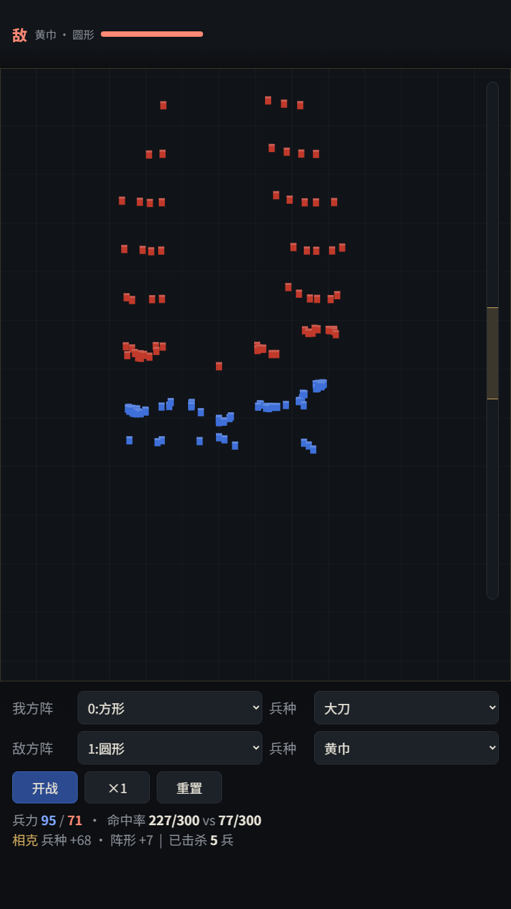
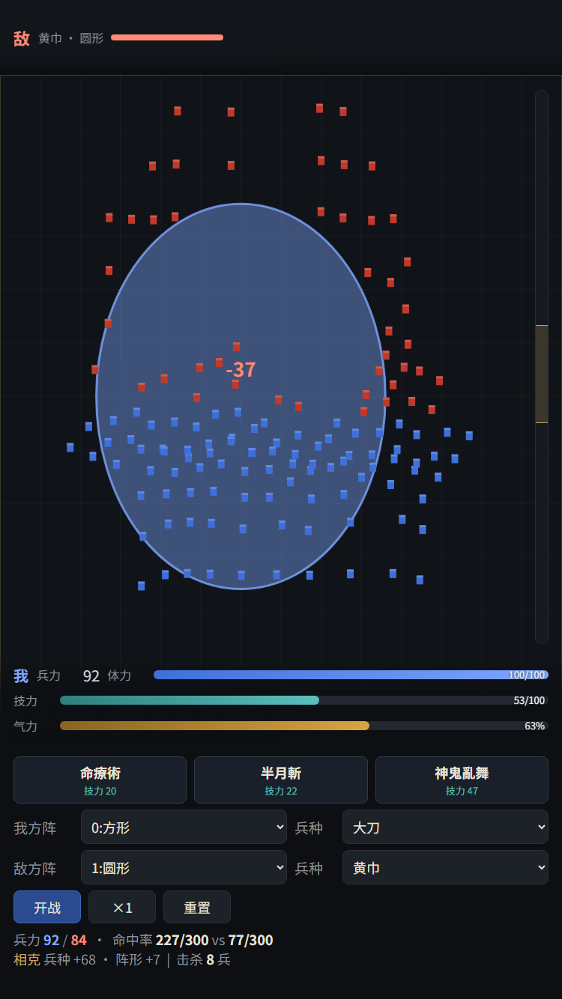

# 09 · 竖屏战斗原型说明（v0.2）

> **一句话**：这是一个**纯前端、零依赖、双击就能玩**的竖屏 100 v 100 兵战原型，跑的是**原作规则**（同一条战力公式 + `rand()%300` 命中 + 兵种/阵形相克 + 技力/气力双资源武将技），用来在 Cocos 工程开工前把"竖屏战场长什么样、手感对不对、技能怎么点"验证掉。
>
> 状态：**可运行、可截图、34 项自检全过**；已接 3 个武将技（治疗 / 单体 / 范围）与电脑自动放技；未接军师技/结算，单位是色块占位。

---

## 0. 先看这个



（750×1334，sim=300 tick 时的画面：蓝=我方 83 兵、红=敌方 56 兵，前线交错，右侧是竖条小地图）

推进中（sim=240，两军相向而行）：

---

## 1. 这是什么 / 不是什么

| 是 | 不是 |
|---|---|
| 用**原作公式**跑的 100 v 100 实时兵战 | 不是美术演示（单位是 6×9 px 色块） |
| **竖屏 14 车道 × 71 行**的投影与相机验证 | 不是最终渲染方案（最终用序列帧 + 合批，见 `03 §3.13`） |
| 独立于引擎的**纯逻辑核**（`core.js`，UMD，无 DOM） | 不是 Cocos 工程（`04 §2` 的 `core/` 目录将来直接搬这份逻辑） |
| 数据**全部来自** `data/*.json`（原作 INI 1:1 导出） | 没有技能/军师技/单挑/结算/存档 |

**为什么先做它**：竖屏改造里最贵的两个未知是"14 车道够不够读"和"100 人同屏帧率/观感"。这两个问题用 20 分钟的前端原型就能回答，不需要等引擎、不需要等美术、不需要 GPU。

---

## 2. 怎么跑

```powershell
# ① 直接玩（浏览器双击即可，file:// 协议可用，不需要服务器）
start F:\sanguo\proto\battle.html

# ② 跑逻辑自检（34 项）
node F:\sanguo\proto\test_core.js

# ③ 无头截图（写文档/评审用）
& "C:\Program Files (x86)\Microsoft\Edge\Application\msedge.exe" `
  --headless=new --disable-gpu --hide-scrollbars --force-device-scale-factor=1 `
  --window-size=750,1334 --screenshot="F:\sanguo\work\shot.png" `
  "file:///F:/sanguo/proto/battle.html?sim=300&freeze=1"
```

`?sim=N` = 先跑 N 个 tick 再渲染；`&freeze=1` = 不启动 RAF（截图必须加，否则截到的是空帧）。

**界面控件**：我方/敌方阵形（9 选 1）、兵种（13 选 1）、开战、暂停、×1/×2/×4、重置。面板实时显示双方兵力、**命中率（`227/300 vs 77/300`）**、兵种与阵形修正、击杀数。

---

## 3. 文件

| 文件 | 行数 | 作用 |
|---|---|---|
| `F:\sanguo\proto\core.js` | 478 | 纯逻辑：世界创建、`step()`、投影、相机、落位、战力、命中、`cast()` 武将技 |
| `F:\sanguo\proto\battle.html` | 451 | 竖屏画布 + HUD + 技能条 + 点选 + 渲染 |
| `F:\sanguo\proto\test_core.js` | 206 | 34 项断言（`node test_core.js`） |
| `F:\sanguo\proto\data_bundle.js` | 2 | `gen_bundle.py` 生成的数据包（129,198 B） |

`core.js` 对外 API：`createWorld(opts)` / `step(world)` / `project(worldX, worldY, camX)` / `camera(world)` / `formationPositions(...)` / `powerOf(attacker, defender, ...)` / `troopBonus(a, b)` / `formationBonus(a, b)` / `mulberry32(seed)`。

---

## 4. 已实现的原作规则

| 规则 | 实现 | 出处 |
|---|---|---|
| 战力 | `150 + 兵种相克 + 阵形相克 + (士气−50)/5`，下限夹到 5 | `docs/04b §4` |
| 命中 | `rand()%300 < 战力` | `docs/04b` |
| 士兵 | **无 HP，命中即死** | `docs/04b` |
| 兵种相克 | 13×13 反对称矩阵，±68 | `docs/00 §9`、`data/troops.json` |
| 阵形相克 | 9×9 反对称矩阵，±25 | `data/formations.json` |
| 落位 | 11 组阵形 × 4 档人数（10/50/100/200）的**真实 slot 表**，`gx = x + anchorX + (200−N)//25`，A 侧镜像 `70 − gx` | `docs/04b1`、`tools/export_slots.py` |
| 主将 | 站在后阵（A 在 `max x + 2`），兵尽或主将亡即结束，`endReason = 'troops' \| 'general'` | 原作"兵尽则主将败走" |

**关键实现细节（踩过的坑）**：`step()` 必须是**三段式**——① 移动 ② 收集攻击意图 ③ 统一结算。如果边遍历边结算，"命中即死"会让先遍历的一方每 tick 抢到先手，100 v 100 内战会变成一方 100% 胜（已实测复现）。

---

## 5. 竖屏投影（这是本篇最该被复用的部分）

逻辑坐标沿用原作：**71 列（纵深，X）× 14 行（车道，Y）**，格 `96 × 72` 世界 px。战斗页 750×1334，纵向切三段：**HUD 100 / 战场 900 / 控制台 334**。

```
s        = 750 / 1008 = 0.7440          // 14 车道 = 14×72 = 1008 世界 px → 铺满 750
LANE_PX  = 72 × s      = 53.57 px      // 车道间距（横向）
ROW_PX   = 96 × s      = 71.43 px      // 一行纵深（纵向）
screenX  = worldY × s
screenY  = 550 + (worldX − camX) × ROW_PX   // 我方 worldX 大 → 画面下方
一屏可见  = 14 车道 × 12.6 行（900 / 71.43）
```

**相机**：`camX = (A 前锋 + B 前锋) / 2`（A 前锋取 `aMin`、B 前锋取 `bMax`）；一侧清空后退回存活方包围盒中心；夹到 `[6.3, 63.7]`（`half = 450/71.43`）。当前是**硬切**，M1 要换成带死区的平滑跟随（`02 §5`：死区 ±144 世界 px、每帧 ≤8 px）。

---

## 6. 调参与实测

| 参数 | 过程 | 定稿 | 说明 |
|---|---|---|---|
| `ATTACK_COOLDOWN` | 18 → 36 → 60 → 90 → 120 → 150 | **120 tick（4 s）** | 单局时长 12.8 → 26.4 → 29.0 s，最终 **28.6 s** 均值 |
| `MOVE_PER_TICK` | 0.05 → 0.09 | **0.09** | ≈2.7 格/s，接战前有 6~8 s 推进 |
| `SEP_D / SEP_PUSH` | 无 → 0.55 / 0.03 | **0.55 / 0.03** | 没有分离力时 100 人叠成一个点 |
| `ENGAGE_RANGE` | — | **1.15 格** | 进入即互砍 |

**实测时长（10 局均值）**：cd 60 → 18.5 s、90 → 20.6 s、120 → 26.4 s、150 → 29.0 s。
**教训**：单局时长对冷却时间**次线性**——时间主要花在"走到接战"而不是"砍杀"，调 cd 不如调移动速度/初始间距。这条写进 M1 的调参手册。

---

## 7. 自检清单（22 项规则 + 12 项武将技 = 34 项，`node test_core.js`）

1. 18 组（9 阵形 × 两侧）各 100 人落位：**共 1800 点，无越界、无重叠**，`B.maxX = 20 < A.minX = 50`（两军不重叠）
2. 同 seed 同结果（确定性）
3. 战斗必在 180 s 内结束（无死锁）
4. 强克制（大刀 vs 黄巾）→ **100% 胜**
5. 完全镜像 → **57%**（先手优势已被三段式结算消掉大半）
6. 被克（黄巾 vs 大刀）→ **0% 胜**
7. 阵形 +7 修正在 100 v 100 中**可测**（100% 胜率差）
8. 公式：`150 + 68 + 25 = 243`、负向夹到 ≥5
9. 投影：`s = 0.7440`、`ROW_PX = 71.43`、`LANE_PX = 53.57`、14 车道正好铺满 750、一屏 12.6 行
10. 数据完整性：13 兵种 / 9 阵形 / 11 组 slot / 110 技 / 401 武将

---

## 8. 已知差距（M1 要补的）

| 差距 | 影响 | 去向 |
|---|---|---|
| 无色块以外的任何美术 | 观感无法评估 | M4（序列帧 + Spine，`03 §3.13`） |
| 只接了 3 个武将技、军师技完全没有 | 战斗策略少一半 | M3（110 技数据 + `docs/05c` 特效映射已就绪） |
| 无结算界面 | 打完就停在原地 | M1 |
| 相机硬切、无镜头震动/慢镜 | 打击感缺失 | M1 |
| 士兵不显示朝向 | 背视/正视的美术需求看不出效果 | M1（A 方案的核心卖点之一） |
| 单线程 100 人 O(n²) 邻域 | 100 人 60 fps 无压力，200 人会掉 | M1 上空间哈希（`04 §4` 已写） |
| 没有 Cocos 工程骨架 | 逻辑核还没被引擎验证 | M0/M1（`core.js` 直接搬进 `core/`） |

---

## 8.5 v0.2 新增：武将技（技力 / 气力 / 点选）



（`?sim=230&cast=104,36,6`：技力 100→53、气力 65%→63%，紫色环内 **-37** 名敌兵，HUD 里三条资源条与三个技能按钮）

### 8.5.1 双资源：技力 + 气力

| 资源 | 数据来源 | 原型实现 | 是否忠实 |
|---|---|---|---|
| **技力 MP** | `MagicDef.MP`（`data/magics.json` 的 `mp`，20~50） | 上限 = `60 + 智力/2`；**不自动回复**；每次施放扣该技的 `mp` | **忠实**（原作也只有军师技才回技力）；上限公式因 `BaseMP` 未导出而用代理值，已在文档标注 |
| **气力 QI** | `POWER×1200`，满条 `60000`（`04b`）/ `120000`（`04b3`） | 满条 **120000**、每秒回 6000、单次消耗 **12000**（= 10% 条） | **改过**：本版 `MAGIC.INI` 的 `POWER` 恒为 100，按原作系数一次要吃掉整条，28 秒的对局放不出第二次；系数缩到 `×120` 并在代码注释与本节标明是【新设计】 |

**为什么是这两个资源**：原作就是双资源——`MP` 决定"能不能放"，`氣力` 决定"放得多快"（`04b §4`）。原型把这两条都做出来，是为了验证竖屏上**两条资源条 + 一个技能排**是否挤得下（结论：750 宽下三条 12 px 条 + 三个按钮，占用 124 px，可接受）。

### 8.5.2 三个代表技

| 按钮 | seq | 技力 | ATTACK | 类型 | 效果 | 半径 |
|---|---|---|---|---|---|---|
| 命療術 | 1 | 20 | 30 | `heal` | 主将 +`20+ATK` 体力（封顶）、士气 +3 | 自身 |
| 半月斬 | 50 | 22 | 12 | `strike` | 范围内敌兵按 `15% + ATK×1.0%` 死亡；主将改为扣 `8+ATK/2` 体力 | 1.8 格 |
| 神鬼亂舞 | 104 | 47 | 60 | `aoe` | 范围内敌兵按 `20% + ATK×0.8%` 死亡（上限 80%） | 3.6 格 |

其余 107 个技按 `ATTACK` 走通用规则（`≥40` 当 AoE、`≥1` 当单体、`=0` 当 buff 加士气）。**注意：原作的具体伤害在 `MAGIC.SO` 脚本里逐技不同**（`docs/05c`），这里是"用一个可解释的近似"验证交互，不是还原。

### 8.5.3 竖屏点选（这是本节真正要验证的东西）

```
点技能按钮 → armed = seq（按钮高亮 + 战场出现"点战场选择落点"提示）
            ↓
手指在战场移动 → 画半透明虚线椭圆（半径随技能变）
            ↓
点战场 → C.cast(world,'A',seq,worldX,worldY) → 环 + 飘字（-37 / +50）
            ↓
再点同一个按钮 = 取消（不会误放技能）
命療術（heal）不需要落点，点了立刻放
```

屏幕 → 世界的反算只有两行：

```
worldY = screenX / LANE_PX
worldX = camX + (screenY − 550) / ROW_PX
```

**已验证**：命中判定用目标点与所有单位的**真实格子距离**（`dx²+dy² ≤ r²`），所以在椭圆看起来"盖住"的地方才真的会被打到——不存在"点击判定和视觉不一致"的问题。

### 8.5.4 电脑放技

`tickSkills()` 每 10 秒让电脑主将试一次：按 `MP` 从低到高找放得起的技（先 `半月斬` 后 `神鬼亂舞`），目标挑**周围 3 格内友军最多**的那个我方单位。测试里 `ai:{A:true,B:true}` 可让双方都走这套逻辑，用来验证"完全镜像对局仍是 50%±25%"（实测 9:11）。

### 8.5.5 新增的自检（在原有 22 项之外，共 34 项）

| # | 断言 | 实测 |
|---|---|---|
| 1 | 三个代表技都能按 `seq` 找到 | 命療術 / 半月斬 / 神鬼亂舞 |
| 2 | 施放成功并扣技力 | 100→53（消耗 47） |
| 3 | 同时扣气力 | 42000→30000 |
| 4 | 气力上限 120000、单次消耗 12000 | ✓ |
| 5 | 技力不足时拒绝施放**且不扣气力** | `reason=mp` |
| 6 | 命療術治疗并封顶到上限 | hp 20→70（+50） |
| 7 | AoE 在密集敌群里击杀 > 0 | 半径 3.6 内 100 人，击杀 46 |
| 8 | 空旷处 AoE 不误伤 | killed = 0 |
| 9 | 气力随时间回复（+200/tick） | 42000→54000 |
| 10 | 电脑双方都会放技（60 秒内 ≥2 次） | 6 次 |
| 11 | 同 seed + 同操作结果一致 | B 剩余 100 vs 100 |

---

## 9. 下一步（按性价比排序）

1. ~~**接技能**~~ ✅ **v0.2 已完成**（3 个代表技 + 双资源 + 点选）。
2. **接结算**：胜负 → 双方伤亡 → 主将经验/战功（公式在 `docs/04b §6`），让原型能"打一局、出结果、再来一局"。
3. **搬进 Cocos**：`core.js` → `assets/scripts/core/`，渲染换成序列帧 + 同图集合批，量一次真机帧率（这是 M0 的性能沙盒 Gate）。
4. **把 110 技的脚本伤害接进来**：`MAGIC.SO` 已反汇编（`export/script/magic_so.dis.txt`），可以做一个小解释器按 `Script` 号跑真实伤害，替换现在的近似规则。
5. **等云有卡**再跑 `cloud/jobs_v0.csv` 的 27 条出图（当前阻塞，见 `07`）。
